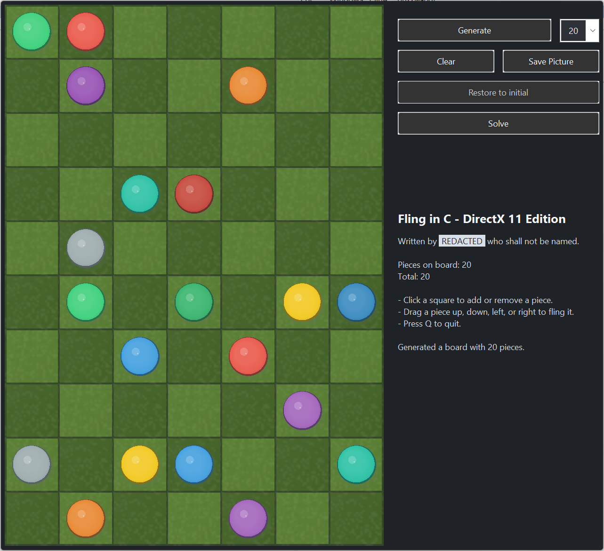

DESCRIPTION
-----------
Fling in C - DirectX 11 Edition

A simple but interesting puzzle game. Several pieces on the board, you can
fling a piece towards another to bump it off the board, the goal is only one
piece remains.

<video controls src="https://github.com/user-attachments/assets/786829a7-b258-4571-8931-5b58065cf586" muted="false"></video>

LICENSE
-------
This code is written by jdp1024.

Distributed under GPLv3.

PURPOSE
-------
This one single file program demonstrates how to implement the game Fling
using pure C (C11 standard) and Win32 APIs with multiple Windows programming
techniques:

* create windows and custom controls with DPI-awareness and theme-awareness
* borderless window management
* dynamic controls layout
* handle user input and drag-and-drop operations
* GDI programming and resource management
* owner-draw controls
* custom system menu items
* dark/light theming support that can be switched at runtime
* load and save program settings
* simple tagged text rendering for displaying information and status
  messages
* hot area detection and responding
* board generation in a separate thread to keep the UI responsive, while
  keeping in mind that some C runtime functions are not thread-safe
* reduce executable file size with various tricks and optimizations
* use Windows Imaging Component (WIC) and common knowledgement of pixel
  formats
* simple sound effect and short melody playback, dynamically generated by
  MIDI sequence with the Windows Multimedia API
* continuous score-based background MIDI music with independent melody,
  chord, and sound-effect channels
* basic knowledge of application manifest

and DirectX 11 programming:

* call COM interfaces directly with lpVtbl pointers
* rendering with DirectX 11 in windowed mode
* anti-aliased sprites and simple shaders
* a simple animation system using the Windows Animation Manager to
  animate piece movements smoothly
* a "bump" effect when pieces collide during animation
* long animation sequences by a combination of multiple animation segments
  and different effects
* AVX2 optimizations for bitmap alpha blending

and, of course, the core logic for the Fling game:

* solution finding with DFS and hashing algorithms

INSTRUCTIONS
------------
You can compile this code with the provided batch file, build.bat. It uses
the Microsoft C/C++ Compiler, which can be freely obtained by downloading
Visual Studio Community Edition from Microsoft website.

The compiler and linker flags used in build.bat demonstrate various tricks
to reduce the final executable file size.

You can also compile it with any C11 compatible compiler on Windows such as
GCC or clang, you may also need the latest Windows headers and libraries
and adjust the compiler and linker flags accordingly. Also, since only
the Microsoft SDK contains the lpVtbl definitions for COM interfaces,
you may need to convert this code to C++ (but without any modern features)
to call the COM interfaces with the more natural syntax.

SPECIAL NOTES
-------------
If you build the code with provided build.bat, the resulting executable file
size should be less than 64KB, which is even smaller than a modern color icon
file. Since the code is already very compact and optimized for size, I decided
not to add more features since this program is mainly intended to demonstrate
the core concepts and techniques in a concise and clear way, and adding more
features may make the code more complex and harder to understand.

Some error handling code and some checks are omitted in this code for brevity
and to reduce the code size, so be aware that this code is not production
quality and may crash or behave unexpectedly in some cases. It is only
intended to demonstrate the core concepts and techniques, and should be
used as a reference or starting point for learning and experimentation.

All objects are stored in global variables to reduce the code size. Dynamic
memory allocation is avoided as much as possible.

To enable Common Controls version 6 without any external manifest file, I
used a tricky method: load the manifest from explorer.exe. The standard manifest
file is also included (app.manifest) for reference, but it is not used in the
build process.

This program only runs on Windows 10 and 11 because of the modern Windows APIs
it depends on (like DPI-related functions). You are encouraged to rewrite
some parts of the code to make it work on older versions of Windows.
